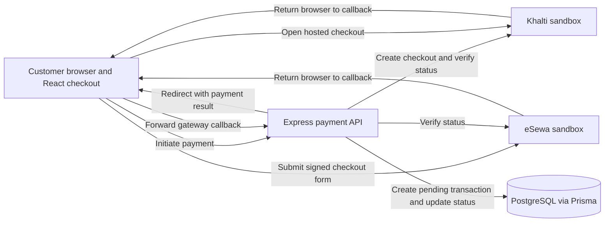

# Payflow

Payflow gives merchants a checkout page at `/pay/:slug`. Customers can pay with Khalti or eSewa, and the backend records both gateways in one transaction table.

## Architecture



## Server-side payment verification

1. The backend looks up the merchant and starts a checkout. Khalti returns a hosted payment URL and a payment ID (`pidx`). For eSewa, Payflow creates a transaction UUID and returns a signed form for the browser to submit. Both paths record a `pending` transaction before returning checkout details.
2. When the browser reaches `/api/payments/khalti/callback`, the backend submits the callback's `pidx` to Khalti's lookup API using the server-side secret key. At `/api/payments/esewa/callback`, the backend decodes the Base64 JSON callback and queries eSewa's status API with the transaction UUID, total amount, and product code.
3. The gateway response's status determines the result. The backend uses the external reference to find and update the existing transaction, then redirects to `/pay/:slug?payment=<status>`. The `payment` query parameter is display feedback for the checkout. The saved transaction is the merchant's record.

| Gateway | `success` | `pending` | `failed` |
| --- | --- | --- | --- |
| Khalti | `Completed` | `Pending`, `Initiated` | Other lookup status values |
| eSewa | `COMPLETE` | `PENDING`, `AMBIGUOUS` | Other status response values |

## Unified gateway schema

Both providers use the same Prisma `Transaction` model in PostgreSQL. A `Merchant` can have many transactions. See [the Prisma schema](backend/prisma/schema.prisma).

| Field | Prisma type | Meaning |
| --- | --- | --- |
| `id` | `String` | Payflow primary key generated as a UUID |
| `merchantId` | `String` | Required foreign key to `Merchant.id` |
| `amount` | `Decimal` | Amount in Nepalese rupees. Khalti initiation sends the equivalent in paisa. |
| `paymentMethod` | `String` | `khalti` or `esewa` |
| `status` | `String` | `pending`, `success`, or `failed` |
| `externalRef` | `String?` | Unique when present. Stores Khalti's `pidx` or the eSewa transaction UUID. |
| `createdAt` | `DateTime` | Creation timestamp, defaulting to the current time |

## Run locally

Use Node.js 24, npm, and a PostgreSQL development database. Install the frontend and backend dependencies from the repository root.

```sh
npm ci
npm ci --prefix backend
```

Set `DATABASE_URL` and `JWT_SECRET` in `backend/.env`. For sandbox payments, set `KHALTI_SECRET_KEY` and `ESEWA_SECRET_KEY`. The eSewa product code defaults to `EPAYTEST` and can be set with `ESEWA_PRODUCT_CODE`. For Google login, set `GOOGLE_CLIENT_ID` in `backend/.env` and the same value as `VITE_GOOGLE_CLIENT_ID` in the root `.env`.

From `backend`, apply the existing migrations to the development database, generate the Prisma client, and start the API.

```sh
npx prisma migrate deploy
npx prisma generate
npm run dev
```

In a second terminal, run `npm run dev` from the repository root. The frontend defaults to port 5173 and proxies `/api` to port 5000. Set `FRONTEND_URL` and `BACKEND_URL` in `backend/.env` if the checkout or callback needs a different origin.

## Run the payment tests

```sh
npm --prefix backend test
```

Unit tests cover status mapping for both gateways. Integration tests send HTTP requests through the Express router and check gateway lookup requests, transaction updates, and redirects. They use mocked gateway responses and a test double for the transaction store, so they run without a database or gateway credentials. GitHub Actions runs both suites on pushes and pull requests. [Payment workflow](.github/workflows/payment-tests.yml)
